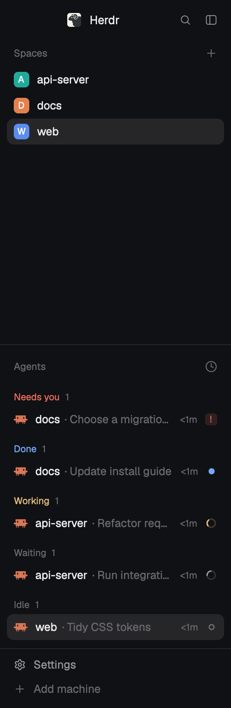

# herdr-agent-waiting-mod

A [Herdr](https://herdr.dev) mod, [`agents-waiting`](agent-waiting/RECIPE.md), and the agent hooks that feed Herdr: Claude Code's background work, and Cursor's status.

Claude Code ends its turn as `done` even while its `run_in_background` shells are still running. With this mod Herdr's agents list has a **Waiting** section: an agent you've already seen, at rest, with background work still running. A new finish still shows as Done first.

Cursor Agent CLI reports no status at all (no OSC 7501), so Herdr shows a Cursor pane as a program, not an agent. The Cursor hook reports idle, working and done for it, so Cursor is in the agents list like any other agent. That part works with Herdr's own `agents` mod too.

[Example: an agent watching a dev server](agent-waiting/examples/dev-server.md), a recorded run with two background monitors.

## Install

Ask an agent in Herdr to add `github.com/zztalker/herdr-agent-waiting-mod/tree/main/agent-waiting`, or follow [Use it](agent-waiting/RECIPE.md#use-it). In short:

1. An hc with `hc report`: [herdrdev/herdr-core#81](https://github.com/herdrdev/herdr-core/pull/81), not released yet. Until then: [herdr-core 0.1.19 + hc report](https://github.com/zztalker/herdr-core/releases/tag/0.1.19-report.1) (Linux, macOS, Windows).
2. The hooks, on every machine where Claude Code or Cursor runs: `sh agent-waiting/hooks/install.sh` installs the hook of each agent it finds (`--uninstall` removes them). On Windows (Cursor only): `powershell -NoProfile -ExecutionPolicy Bypass -File agent-waiting\hooks\install.ps1`. Both say so if hc has no `hc report`.
3. The mod: copy `agent-waiting/mods/agents-waiting/` to `~/.config/herdr-app/mods/` and point your layout's agents block at `agents-waiting`.

What it runs: the mod, nothing (it reads `agents()` and `terminals()`). The hooks run `hc report` (and `jq`, in `sh`). The installers edit `~/.claude/settings.json` and `~/.cursor/hooks.json`, beside your own hooks, keeping a backup. No network.

## License

Apache-2.0 (see `LICENSE`). `agents-waiting` is modified from Herdr's shipped `agents` mod (Apache-2.0); the changes are marked `waiting:` in the source.
