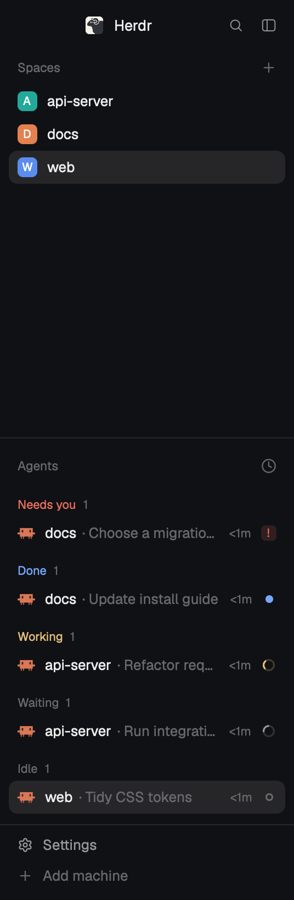

# Agent Waiting

Herdr's agents list, with one more state: **Waiting**. Claude Code ends its turn with `done` even while shells it started with `run_in_background` are still running, so Herdr says the agent finished while it is still at work. With this mod, and the Claude Code hook that ships with it, such an agent first shows as Done like any finish; once you have seen it, it sits in its own **Waiting** section with a slow grey spinner until its background shells end, and then it is Idle.

It also ships a hook for **Cursor Agent CLI**, which reports no status of its own (no OSC 7501), so Herdr shows a Cursor pane as a program, not an agent. The hook reports Cursor's idle, working and done, and Cursor is listed like any other agent, with this mod or Herdr's own `agents`.



A recorded run, an agent with two monitoring scripts in the background: [examples/dev-server.md](examples/dev-server.md).

## Use it

It takes three pieces. The mod draws the state; the hook and `hc report` feed it.

1. **An hc with `hc report`.** The hooks report through it: `hc report state=working:id=bg` for Claude Code's background shells, `hc report state=working:app=cursor` for Cursor. That command is in [herdrdev/herdr-core#81](https://github.com/herdrdev/herdr-core/pull/81), not yet in a herdr-core release. Until it is, use the build of that branch: [herdr-core 0.1.21 + hc report](https://github.com/zztalker/herdr-core/releases/tag/0.1.21-report.1) (Linux, macOS and Windows, unofficial; its notes have the Windows steps):

   ```sh
   tar -xzf herdr-core-<platform>.tar.gz
   hc update --from ./herdr-core              # Linux
   hc update --from './Herdr Core.app'        # macOS
   ```

   It still says `hc 0.1.21`. `hc update` and `hc machine update` bring back the official build, without `hc report`; on another machine, copy the Linux `herdr-core` to its `~/.local/bin/` and run `herdr-core server restart` there instead. Running terminals keep running either way. Check with `hc report --help`.
2. **The hooks**, on every machine where Claude Code or Cursor runs (this computer and each machine from `hc machine ls`). One installer puts in the hook of each agent it finds there (`~/.claude` or `claude`; `~/.cursor` or `cursor-agent`) and skips the rest. It needs `jq`.

   ```sh
   sh agent-waiting/hooks/install.sh               # install or update
   sh agent-waiting/hooks/install.sh --uninstall
   ```

   On Windows, for Cursor (the Claude Code hook is `sh` only):

   ```powershell
   powershell -NoProfile -ExecutionPolicy Bypass -File agent-waiting\hooks\install.ps1
   powershell -NoProfile -ExecutionPolicy Bypass -File agent-waiting\hooks\install.ps1 -Uninstall
   ```

   - **Claude Code:** `herdr-background-waiting-hook.sh` in `~/.claude/hooks/`, and one `Stop` entry in `~/.claude/settings.json` (the old file is kept as `settings.json.bak-pre-bg-hook`).
   - **Cursor:** `herdr-status-hook.sh` (Windows: `.ps1`) in `~/.cursor/`, and `sessionStart`, `beforeSubmitPrompt`, `stop` and `sessionEnd` entries in `~/.cursor/hooks.json` (the old file is kept as `hooks.json.bak-pre-herdr-status-hook`).

   Entries go after your own hooks, with the full path of `hc` in each command. New sessions use them; restart the running ones.

   **If the installer ends with `WARNING: … has no 'hc report'`, tell the person**: the hooks are in place but report nothing until step 1 is done on that machine.
3. **The mod**, on the computer with the Herdr window. Copy `agent-waiting/mods/agents-waiting/` to `~/.config/herdr-app/mods/` and point a layout's agents block at it. For Herdr's main layout:

   ```sh
   herdr-app do layout.clone '{"name":"main","as":"main-waiting"}'   # switches to it
   sed -i.bak 's/"mod": *"agents"/"mod": "agents-waiting"/' ~/.config/herdr-app/layouts/main-waiting.json
   herdr-app check ~/.config/herdr-app/mods/agents-waiting
   ```

   In your own layout, change its `{"mod": "agents"}` the same way. `ctrl-shift-l` switches layouts back.

Without the hooks or without `hc report` nothing changes: no agent has a `bg` record, Cursor is shown as a program, and the list is Herdr's own.

## What you see

The shipped `agents` mod as it is (sections, cards, sort menu, pins, narrow rail), plus:

- **Priority view:** sections in this order: **Needs you**, **Done**, **Working**, **Waiting**, **Idle**. The Waiting header is in the theme's `dim` color, like Idle's (no theme has a `waiting` color yet; the header and spinner use one if it appears).
- **Its rows:** like an idle agent's row, but the status mark is the shipped spinner (`mods/workspace-chrome/spinner.svg`, 12px) in `muted`, turning once every 2.4 s (working: `working` color, every 0.9 s). Names are not dimmed.
- **Grouped by space:** a folded group shows the waiting spinner when waiting is its most urgent state.
- **Sub-agents:** a sub-agent whose displayed word is idle and that has a `bg` record shows the same spinner.

## How it behaves

- **working:** yellow spinner, in Working. **blocked:** `Needs you`, at the top. **done:** blue dot, in Done until you look at it. **idle:** grey ring, dimmed name.
- **waiting:** an agent whose own status is `idle` and that has a 7501 child record `bg` in state `working`. A `done` agent stays done whatever its records say: a finish is news until seen.
- **The usual life of a Claude Code turn with a background shell:** Claude reports `done` and the hook reports `bg`: Done. You open it: Herdr marks it seen and idle, so it is Waiting. (An agent that finishes while you are already on it stays under Done until you leave it, as in the shipped list.) The shell ends, the hook clears `bg`: Idle. Claude starts a new turn: Working, with `bg` kept until that turn's end decides again.
- Clicks, keys, hovers, pins, sort and navigation order are the shipped mod's; waiting agents take part in them like any other.

## Built from

- **Mod:** `mods/agents-waiting/`, a copy of Herdr's shipped `agents` mod from herdr-app 0.1.13 (Apache-2.0). Every change is marked `waiting:` in `main.js`:
  - `RANK = { blocked: 5, done: 4, working: 3, waiting: 2, idle: 1 }`, `SECTION` and `SECTION_STATUS` with `2: "Waiting"` / `"waiting"`;
  - `waits(status, terminal)`: `status === "idle"` and `terminal.records.bg.state === "working"`;
  - in `render`, `terminals()` is read first and indexed by `address`; each `agents()` entry that `waits` gets `status: "waiting"` before anything else sees the list;
  - `kidStatus` applies `waits` to the word a sub-agent displays;
  - `hold` / `rank` treat `waiting` like `idle`, so an agent that finishes while you are looking at it stays in Done until you leave it;
  - `status()` draws the waiting spinner.
- **Data:** `agents()` (status words) and `terminals()` (each terminal as core describes it, including its 7501 `records`). Records of terminals on other machines come through the same way.
- **Hook:** `hooks/claude-code/herdr-background-waiting-hook.sh`, a Claude Code `Stop` hook. It runs only inside a Herdr terminal (`HC_TERMINAL_ID`), finds the session's file in `~/.claude/sessions/` by `session_id`, and reads its `status`: `shell` means the turn is over and a background shell is alive. Then it runs `hc report state=working:id=bg` and leaves a detached watcher that polls the file every 2 s (`HERDR_BACKGROUND_WAITING_POLL`) and runs `hc report state=clear:id=bg` once the session is idle again or gone. One watcher per terminal; each Stop takes over from the previous one. It never writes the agent's own status.
- **Cursor hook:** `hooks/cursor/status-hook.sh` and `status-hook.ps1`, for Cursor's `sessionStart` (idle), `beforeSubmitPrompt` (working, and lets the prompt through), `stop` (done; error if it errored, idle if aborted) and `sessionEnd` (cleared). They report Cursor's own status on the terminal's root record with `hc report …:app=cursor`, only inside a Herdr terminal, and always give Cursor its answer whatever hc does. Cursor runs hooks detached, with no terminal to print OSC 7501 to, hence `hc report`. No `blocked`: Cursor has no hook for "waiting on your approval".
- **Installers:** `hooks/install.sh` runs `hooks/claude-code/install.sh` and `hooks/cursor/install.sh` for the agents it finds and checks `hc report` once; `hooks/install.ps1` is Windows' (Cursor). Plain `sh` and `jq`, or PowerShell 5.1/7; idempotent; they write the full path of `hc` into each hook's command (`HERDR_HC=…`, or the `.ps1` hook's second argument).
- **Tests:** `sh hooks/install.test.sh`, `sh hooks/cursor/install.test.sh`, `sh hooks/cursor/status-hook.test.sh`; `pwsh -NoProfile -File hooks/install.test.ps1` and `hooks/cursor/status-hook.test.ps1` (Windows: `powershell -NoProfile -ExecutionPolicy Bypass -File …`). They use a throwaway config folder and fake hc's.
- **Programs it runs:** the mod runs none. The hooks run `hc report` (and `jq`, in `sh`).

## Watch out

- **Name:** it is a new mod beside the shipped `agents`, not an edit of it: Herdr restores shipped mods on start. A layout only uses it once its block says `"mod": "agents-waiting"`.
- **Version:** built from herdr-app 0.1.13's `agents` mod. When Herdr changes its own, this copy doesn't follow; rebuild from this recipe on the new version (the changes above are small and self-contained).
- **`hc report` is the dependency:** with an hc that doesn't have it, the hooks' reports fail silently and nothing is shown. The installers warn when `hc report --help` fails. The hooks and hc run on the machine where the agent runs, so each remote machine needs both.
- **Polling:** Claude Code has no event for "background shell finished", hence the 2 s watcher. Waiting can lag a shell's end by up to that.
- **Waiting is only Claude Code's:** other agents need their own hook that reports `bg` the same way; the mod works for any agent that does. The Cursor hook reports Cursor's status, not `bg`.
- **Cursor's hooks.json is Cursor's:** the hook relies on its `sessionStart`, `beforeSubmitPrompt`, `stop` (with `status`) and `sessionEnd` hooks, as in Cursor Agent CLI 2026.11. Once Cursor reports OSC 7501 itself, uninstall the Cursor hook.
- **The session file is Claude Code's, not an API:** the hook relies on `~/.claude/sessions/<pid>.json` with `sessionId` and `status` (`busy`, `shell`, `idle`), as in Claude Code 2.1.31x. If that changes, the hook stops reporting and the agent is shown as Herdr would show it.

## Done when

- `herdr-app check ~/.config/herdr-app/mods/agents-waiting` passes, and `herdr-app status` shows no errors with the layout using it.
- Without any `bg` record, the list looks exactly like the shipped one.
- On an idle agent `t5`, `hc report state=working:id=bg --terminal t5` moves it to **Waiting** within a second; `hc report state=clear:id=bg --terminal t5` moves it back to **Idle**.
- On a `done` agent you haven't looked at, the same report leaves it in **Done**; once you open it, it is in **Waiting**.
- In Claude Code, `sleep 120` with `run_in_background`, then end the turn: Done, then Waiting once seen, then Idle about 2 s after the sleep ends. `hc get <agent>` shows `records.bg` while it waits.
- A new Cursor session started from Herdr is in the agents list as idle; a prompt makes it working, its answer done. `hc get <terminal>` shows `status: {app: cursor, state: …}`.
- The hooks' tests pass.
