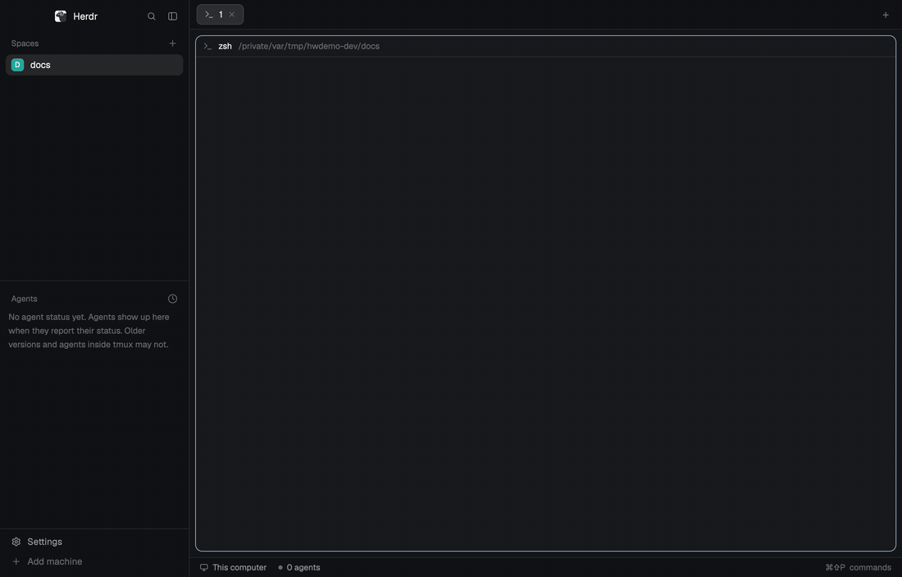

# Example: an agent watching a dev server



A real Claude Code session (Haiku 5.5, Claude Code 2.1.316) in a Herdr window with this mod, the hook and herdr-core with `hc report`, recorded at real speed. The space `dev-server` holds the agent; `docs` is a plain shell to look at instead.

The agent gets one task: start two monitoring scripts as background shells, the way an agent leaves a dev server or a CI watcher running, and end its turn at once:

```
sleep 15 && echo monitor-a ok      # run_in_background
sleep 35 && echo monitor-b ok      # run_in_background
```

When a background shell ends, Claude Code wakes the agent with its result, and the agent answers in a short new turn. The person opens the agent after each finish and goes back to `docs`.

| s | What happens | Agents list |
|---|---|---|
| 0 | The agent starts both monitors. | **Working** |
| 7 | Its turn ends with both monitors running. Claude reports `done`; about 2 s later the hook reports `bg`. | **Done** (not seen yet) |
| 12 | The person opens the agent: Herdr marks it seen, so it is idle, and with `bg` it is | **Waiting** |
| 15 | Back to `docs`. | **Waiting** |
| 19 | monitor-a ends; Claude Code wakes the agent. | **Working** |
| 22 | The agent answers and ends its turn; monitor-b still runs. | **Done** (a new finish) |
| 25 | Opened, then left again. | **Waiting** |
| 39 | monitor-b ends; the agent wakes. | **Working** |
| 42 | It answers; no background shell is left. The hook's watcher clears `bg` about 2 s later. | **Done**, unseen, and it stays there |

Without this mod and hook, the agent would be Done at 7 s, and Idle from the moment you opened it at 12 s, although two monitors were still running.

Two lags in the hook show up here:

- **`done` before `bg`:** when Claude's Stop hook runs, its session file can still say `busy`; the watcher then reports `bg` on its first poll, up to 2 s later. The agent shows as Done in between, as a finish does anyway.
- **`bg` after the last shell:** the watcher polls every 2 s (`HERDR_BACKGROUND_WAITING_POLL`), so the record outlives the last shell by up to that.

Why 15 s and 35 s, not shorter: the agent takes about 7 s to start both shells and end its turn. A monitor shorter than that ends inside the turn, and its result is part of the same turn, so it never makes the agent wait.

## Reproduce it

In a Herdr window with the mod's layout, in a space of its own:

```sh
claude --model haiku 'In one message start two monitoring scripts as background Bash shells (run_in_background: true): `sleep 15 && echo monitor-a ok` and `sleep 35 && echo monitor-b ok`. Do not wait for them: end your turn at once with one short line. When a monitor finishes, answer with one short line.'
```

Switch to another space, open the agent from the list after each Done, then leave it. `hc get <agent>` shows `records.bg` while it waits. Herdr marks an agent seen only while its window is focused.
